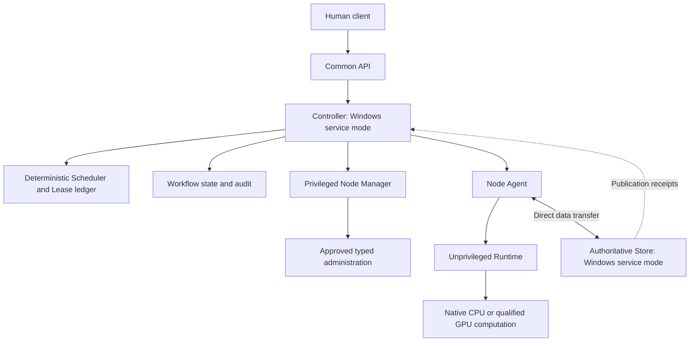
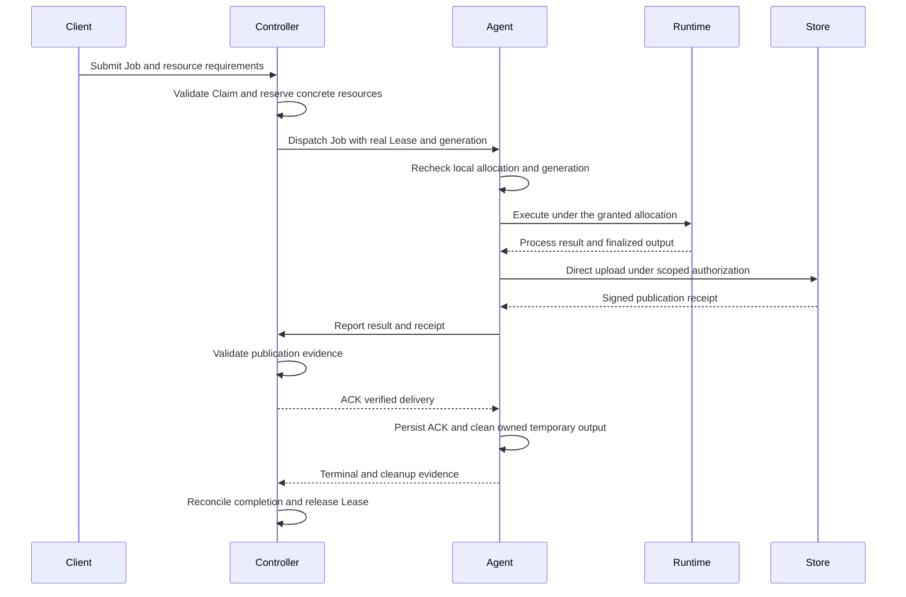

# Architecture

R&D Fabric separates decisions, execution, data transfer and administration.
The Controller coordinates metadata; it does not relay bulk artifacts or perform
workflow computation itself. A physical machine may host several logical roles.

## Logical components

| Boundary | Role |
|---|---|
| Controller | Own durable control state, policy, registry, scheduling intent, Leases and audit |
| Store | Verify declared artifact bytes and publish immutable objects with receipts |
| Node Manager | Independently validate approved typed management requests |
| Agent | Report capabilities and observations; enforce local resource and execution constraints |
| Runtime | Start and observe real native processes under the granted allocation |
| Provider | Normalize platform/backend facts into versioned Fabric contracts |

Windows service mode is implemented for the Controller and Store; its further
physical deployment acceptance is in progress. This is distinct from the future
cross-platform deployment lifecycle milestone.

## Heterogeneous Node contexts

| Context | Bounded capability represented |
|---|---|
| Windows native execution | CPU execution and a qualified dedicated GPU Provider |
| Native Linux AMD64 | CPU execution, ordinary Agent/Runtime lifecycle and selected management packaging |
| Linux AMD64 with AMD GPU | A separately qualified ROCm execution environment |
| Android ARM64 with Termux and Linux PRoot | A constrained Linux execution context for ordinary workloads |

The Scheduler consumes normalized capability, capacity, approval, health,
freshness and reservation facts. It does not branch on a machine nickname or
hardware product name. Qualification belongs to an exact supported environment;
adding a compatible device does not automatically inherit that evidence.

## Job, Lease, receipt and ACK

The following is the configured artifact-delivery path, not a generic promise
that every legacy execution profile publishes to Store.

Process exit alone is not verified artifact delivery. Publication must match the
declared output identity and integrity metadata. The Agent persists the ACK
before removing owned source copies. Delivery recovery reconciles the same
execution rather than recomputing the task merely because a transfer was interrupted.

## Workflow composition

Each workflow task uses the same Scheduler, Claim, Lease, Agent and Runtime path.
The Controller advances dependencies using durable result and publication evidence.
Reducers execute on Nodes. Intermediates use Store, not a separate direct peer
execution protocol.

CPU, memory and GPU allocations describe resources, not guaranteed performance.
Current performance history and Shadow ETA are observation/prediction layers;
adaptive ETA-aware placement is planned, not activated by those observations.
