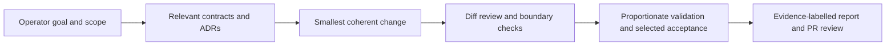

# Engineering process and roadmap

The project advances through contract-led vertical slices, not a list of machines
to support. Every milestone identifies a capability, its normalized contract,
Provider responsibilities and an explicit acceptance matrix.

## Milestone progression

| Stage | Engineering focus | Current interpretation |
|---|---|---|
| M0 | Standalone Controller, local Agent, durable state and basic Jobs | Implemented |
| M1 | Approved multi-Node identity, transport and reconciliation | Implemented with acceptance records |
| M1.5 | Independent Runtime protocol and execution fencing | Implemented with acceptance records |
| M2 and integration increments | Native execution, remote Jobs and verified input/output handoff | Implemented with acceptance records |
| M2.5 | Resource Providers, GPU execution, telemetry and large-data transfer/cache | Implemented with qualified environment records |
| M2.6 | Deterministic, explainable placement | Implemented |
| M3 | Distributed DAG workflows using ordinary Jobs | Implemented with cross-platform acceptance records |
| M3.5 | Resource envelopes, performance history, Shadow ETA, renewable Leases and typed management | Current maturity phase; delivered increments and further work coexist |
| M4 and M4.5 | Persistent Workspace platform and source/environment/execution binding | Planned main integration |
| M5 and M5.5 | Persistent deployment lifecycle and visual workflows | Planned |
| M6 and M6.5 | Operations portal and platform hardening/recovery | Planned |
| M7 | External Chat or local AI orchestration through the Common API | Planned |

The original broad milestone labels evolved into these delivery boundaries.
Implementation of a basic Workspace does not make the persistent Workspace
platform complete. A Windows service implementation does not complete the broader
deployment milestone. Shadow ETA does not enable adaptive scheduling.

M3.5 management has an operator-approved package-definition closure for a bounded
Linux scope. That is not a full qualification verdict. Lifecycle/recovery work
continues on the roadmap. C1: implemented, and passed actual-device acceptance
on one Android ARM64 Node. The 2026-10-13 AT-C1-01 result covers transfer,
reconnection, existing-receipt resume, an actual CPU Job with Lease release and
Store receipt/ACK, and post-transfer exporter observation.
Identity transfer for other Nodes is in progress.

The operating Windows Controller/Store service cutover passed deployment checks;
unattended-boot and crash-recovery acceptance is in progress. Fixed Linux
Agent/Runtime pair maintenance is implemented and tested, with physical acceptance
in progress. These deliveries do not complete the broader deployment platform.

## Evidence before verdict

Acceptance uses distinct layers: generic contract, platform/Provider, backend,
actual device/environment, and multi-Provider integration. A passing build or
isolated fixture cannot substitute for an actual device gate.

Representative recorded campaigns exercised native execution, cancellation,
restart reconciliation, exclusive allocation, verified input staging, artifact
publication/ACK/cleanup and cross-platform workflow completion. Where a result
requires real hardware, the campaign records that execution separately from
controlled metadata and simulated negative cases.

| Evidence label | Meaning |
|---|---|
| PASS | The declared check passed within its recorded source and environment |
| FAIL | The declared check failed; its historical record remains retained |
| NOT RUN | The required action was not executed |
| NOT VERIFIED | Available evidence does not establish the claim |

Independent evaluation checks results, ownership and delivery evidence rather
than accepting a success banner. Fixes append new source-bound results; they do
not turn an earlier failure into a historical pass. Merged code, installed code,
unit tests and physical qualification are separate facts.

The latest recorded same-host Go test/subtest sweep in PR #42 reported
**876 passed, 0 failed and 7 skipped**. Those are snapshot test results, not a
performance benchmark or a device-qualification total.

## AI-assisted development

AI coding agents work inside the same specification and approval boundaries as
other contributors. Repository instructions and a document-routing index keep
recurring prompts short without asking the agent to reload every historical file.

The operator retains decisions about shared contracts, privilege, publication and
deployment. An agent must preserve unrelated work, inspect actual state before
editing, and separate implementation from installation and qualification.
The development assistant is not the product's resource Scheduler.

### Failure handling: A / B / C

| Policy | Situation | Response |
|---|---|---|
| A — Session tooling | Problems in the tool environment or session helper scripts | Correct without a numerical cap, subject to the common rules below |
| B — Operational tools and plans | Corrections to operational tools or plans within the approved scope | At most 15 corrections per task; preserve originals, create a new revision, and add tests for failure cases |
| C — Stop and escalate | Product or contract changes, weakening checks, privilege elevation, signing, ACL or CA changes, irreversible actions, device power actions, or unexpected operational state | Stop immediately and obtain an operator decision |

Common rules:

- Try the same failure with the same method at most twice. On the third occurrence
  of the same cause, report a structural problem instead of repeating that method.
- Record every action in a fix log. An independent reviewer judges the validity
  of each action.
- Unlimited Class A corrections do not waive these common rules or authorize
  a Class C action.

The eventual product goal is for humans and external AI systems to describe
workflows and constraints while Fabric resolves resources, execution and evidence
through deterministic contracts. That orchestration layer remains planned.
