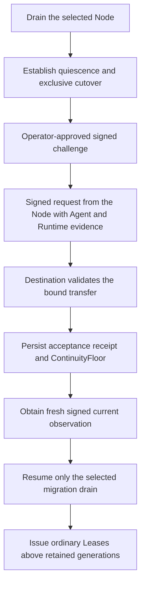

# Trust and continuity model

This page describes design principles, not deployment settings or security
certification. Node identity, workload allocation, package authenticity and
privileged administration are separate decisions.

## Identity is not scheduling authority

Nodes use CA-based identities and authenticated mutual-TLS control connections.
Discovery presents a candidate; enrollment requires operator approval.
An authenticated connection does not by itself grant a workload or management
action. Placement still checks approved resources, compatible capabilities,
freshness, admission state and an actual Lease.

The Agent and Runtime preserve their own generation fences. Controller intent
does not authorize them to accept stale or conflicting work. An AI client uses
the governed Common API rather than acquiring a separate administration channel.

## Signed packages and typed administration

Package publication, operator approval and installation are distinct steps.
Publisher signatures and integrity verification bind the selected package and
components. Packaging is not permission to perform arbitrary administration.

The Node Manager validates Controller-signed requests against approved typed
scopes, target identity, request binding, policy revision, sequence, expiry and
replay state. Normal workloads stay separate from that privileged boundary.
Audit and signed results preserve the distinction between an authorized request,
an applied operation and a verified outcome.

Fixed Linux Agent/Runtime pair maintenance separates applying a version from
verifying it. Its bounded verification requires actual Job, artifact, ACK and
Lease-release evidence before a verified outcome. This flow is implemented and
tested; physical acceptance is in progress.

## C1: signed, audited identity transfer

C1 is an explicit continuity protocol for moving an existing ordinary Node to a
destination Controller while preserving its enrolled cryptographic identity and
execution history. It is not ordinary re-enrollment with reset counters.



The transfer binds the source and destination authority contexts, the existing
Node identity, expected producers and inventory, a bounded challenge, and fresh
Agent/Runtime continuity evidence. Signed acceptance receipts and audit preserve
the relationship between preparation, acceptance and later admission.

## Monotonic ContinuityFloor

Both the Agent and Runtime can retain generation high-water marks beyond a new
Controller's initial counter. The transfer therefore carries a durable floor
derived from their retained evidence, including retired resource entries.

```text
nextGeneration = max(lastIssued, ContinuityFloor) + 1
```

The floor and accepted history are monotonic: persistence rejects rollback, and
restart reconciliation preserves the accepted transfer. Existing local fences
are not reset to make a lower generation acceptable. Unknown safety evidence
remains unknown instead of becoming a zero baseline.

## Drain and resume are separate

Drain stops new ordinary placement while existing work follows its established
Lease and completion rules. Transfer requires quiescence, including no unresolved
execution or output acknowledgment. Resume then requires accepted transfer
evidence, a fresh signed current observation, compatible inventory, healthy
Agent/Runtime relationships and the applicable admission checks.

Resume releases only the selected migration drain. It does not clear an unrelated
management hold or rewrite historical outcomes. Connection, acceptance receipt
and ordinary admission are deliberately separate milestones.

C1: implemented, and passed actual-device acceptance on one Android ARM64 Node.
The 2026-10-13 AT-C1-01 acceptance covered identity transfer, reconnection,
resume using the existing receipt, an actual CPU Job, Lease release, Store receipt
and ACK, and a post-transfer exporter observation.
Identity transfer for other Nodes is in progress. This acceptance does not
establish every deployed environment.
